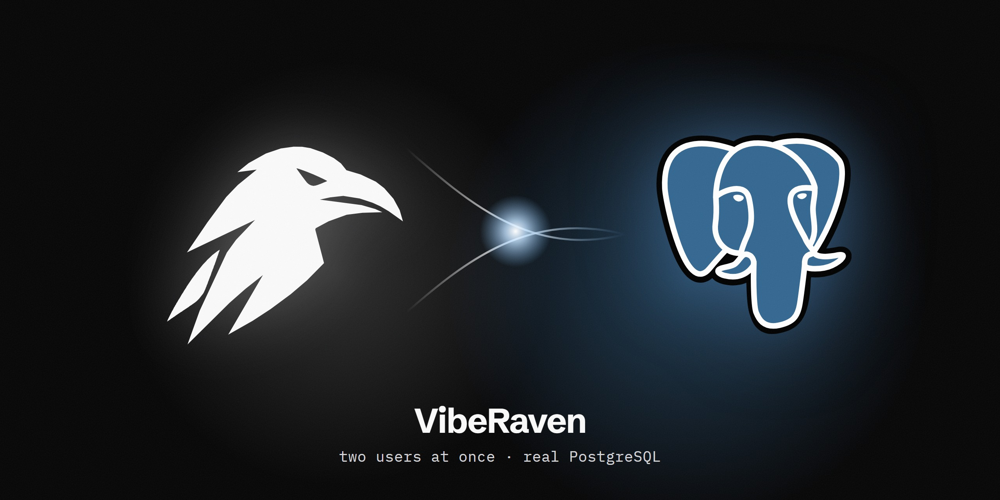
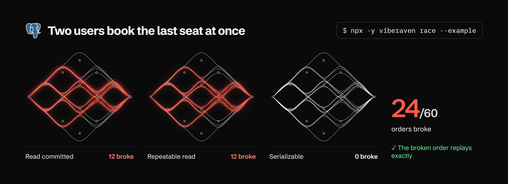
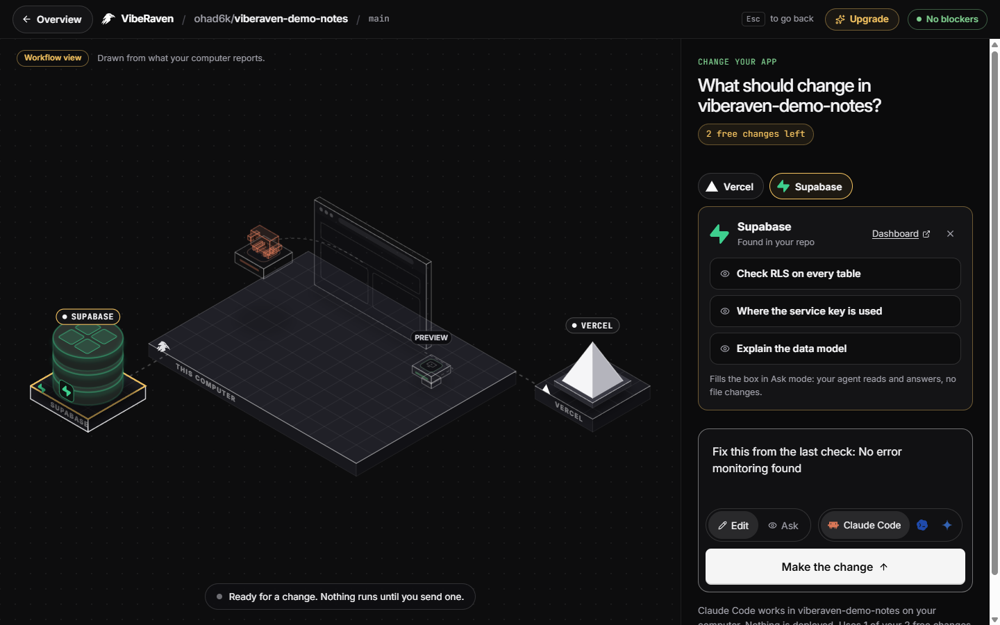

<p align="center">
  <a href="https://viberaven.dev"></a>
</p>

# VibeRaven

Test what happens when two users book the last seat. VibeRaven runs bounded PostgreSQL race tests and lets you replay a failing statement order. It also reviews Supabase migration files for missing row-level security (RLS) and Data API grants.

Run the synthetic booking example in an empty folder with Node 24 or later:

```sh
npx -y viberaven race --example
```

The unguarded example oversold the last seat in **24 of 60 tested statement orders** and exits with code 1. The [booking fixture](https://github.com/ohad6k/VibeRaven/tree/de6208df5a777358251fa87e7457ad5989c33922/examples/race-capacity) shows the guard-row fix and how to rerun the assertion.

<p align="center"></p>

[Use with Claude Code, Codex or Cursor](#use-with-claude-code-codex-or-cursor) · [Check your Supabase migrations](#in-your-repo) · [Connect an MCP client](https://viberaven.dev/connect/mcp)

<p align="center">
  <a href="https://www.npmjs.com/package/viberaven"></a>
  <a href="./LICENSE"></a>
  <a href="https://github.com/ohad6k/VibeRaven/stargazers"></a>
</p>

<p align="center">
  <a href="https://viberaven.dev">Website</a> ·
  <a href="https://viberaven.dev/engine">Engine</a> ·
  <a href="https://viberaven.dev/connect/mcp">Connect your chat</a> ·
  <a href="https://viberaven.dev/docs">Docs</a> ·
  <a href="https://discord.gg/ZAJvazz63Y">Discord</a>
</p>

## In your repo

```sh
npx -y viberaven check   # what is risky before launch
npx -y viberaven race    # what breaks when two users act at once
```

1. `check` reads migrations, client code and env files, and names the file and line for each gap.
2. `race` runs the rule in your `viberaven.race.json`: setup, two requests and the SQL that must stay true. [Spec template](https://github.com/ohad6k/VibeRaven/blob/main/docs/race.md#explicit-spec).
3. Fix, run `race` again, and replay the reported order. Exit 0: no order broke. Exit 1: broken. Exit 2: incomplete.

`race` needs Node 24+ (the CLI enables JSPI). `check` runs on Node 20+.

## Proof

| Frozen-engine check | Result |
| --- | --- |
| PostgreSQL isolation specs | **122/124** |
| Hidden new statement orders | **199/200**, native PostgreSQL 200/200 |
| Hidden real-app interleavings | **1,500/1,500**, native PostgreSQL 1,500/1,500 |
| Byte-equal replays | **80/80** |
| Leaks between sessions | **0** in 60 isolation cases |

[Method and limitations](https://github.com/ohad6k/VibeRaven/blob/main/docs/race.md#frozen-engine-proof)

## How it works

1. Your `supabase/migrations` load verbatim into a fresh, pinned PostgreSQL 18.6.
2. Two independent sessions run in one PGlite WebAssembly instance, with real locks.
3. Bounded statement orders are enumerated and checked against your rule.
4. A broken order replays byte for byte, so a fix can be confirmed.

The engine is [`@viberaven/sessions`](https://www.npmjs.com/package/@viberaven/sessions).

## Use with Claude Code, Codex or Cursor

From the root of your app, run the row for your agent to add project instructions. Append `--dry-run` to preview the changes.

| Agent | Setup |
| --- | --- |
| Claude Code | `npx -y viberaven init --agents claude` |
| Codex | `npx -y viberaven init --agents codex` |
| Cursor | `npx -y viberaven init --agents cursor` |

Then ask: “Review my Supabase migration files for missing RLS and Data API grants. Show the relevant file and line, and tell me what I should verify against my deployed project.”

For ChatGPT, Claude or another remote MCP client, add `https://viberaven.dev/mcp`. The hosted server can review supplied migration SQL or migrations in a supported public GitHub repo. Local MCP tools are available via `npx -y @viberaven/mcp`. See the [agent hub](./AGENTS-HUB.md) for setup and scope.

Building an agent that answers provider errors? The [AI SDK provider-context example](./examples/ai-sdk-provider-context/) adds `search_guides` and `recent_provider_changes` from the hosted MCP endpoint.

## Local Studio

`npx -y viberaven` opens the local Studio: chat with your coding agent, the provider board, versions and diffs, and a **Race test** tab that runs `race` and replays a broken order.



## Packages

| Package | Purpose | License |
| --- | --- | --- |
| [`viberaven`](https://www.npmjs.com/package/viberaven) | The `npx` entry | MIT |
| [`@viberaven/cli`](https://www.npmjs.com/package/@viberaven/cli) | Studio, `check` and `race` | MIT |
| [`@viberaven/mcp`](https://www.npmjs.com/package/@viberaven/mcp) | Local repository tools over MCP stdio | MIT |
| [`@viberaven/sessions`](https://www.npmjs.com/package/@viberaven/sessions) | Several PostgreSQL sessions in one process | Apache-2.0 |

## Limitations

- `check` reads the repository. It does not show which policies are live in Supabase or Vercel, and a clear result is not a security audit.
- `race` covers the SQL, inputs and bounded statement orders you supply. Rules beyond a simple count limit need an explicit spec. Omitted roles run as `postgres`.
- An incomplete run is not a pass. Replay needs the same migrations, spec, options and runtime.
- Cloud Auth, HTTP and external I/O are outside the test. Run only SQL you trust; the engine is not a security sandbox.
- No universal PostgreSQL compatibility, and no advantage over a plain coding agent in bug finding, is claimed.

## License

CLI and MCP: MIT. `@viberaven/sessions`: Apache-2.0, with PostgreSQL and third-party [notices](https://github.com/ohad6k/VibeRaven/tree/main/notices). [Contributing](./CONTRIBUTING.md) · [Security](./SECURITY.md) · [Changelog](./CHANGELOG.md)
