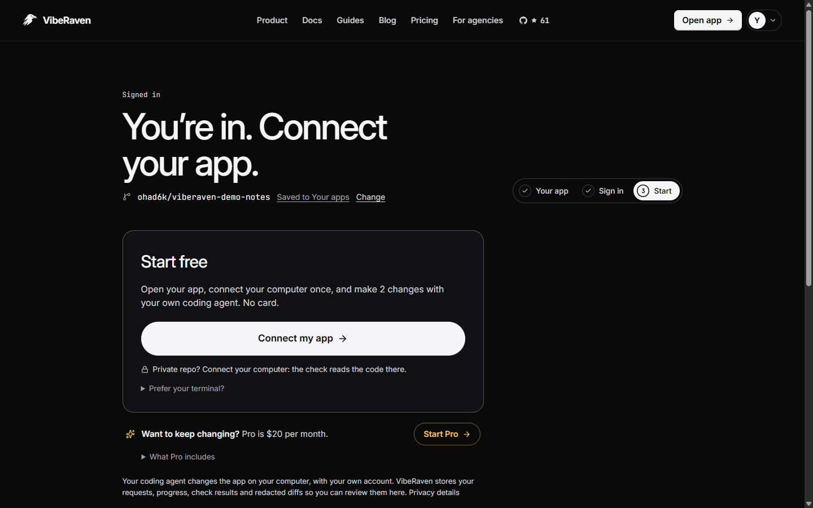
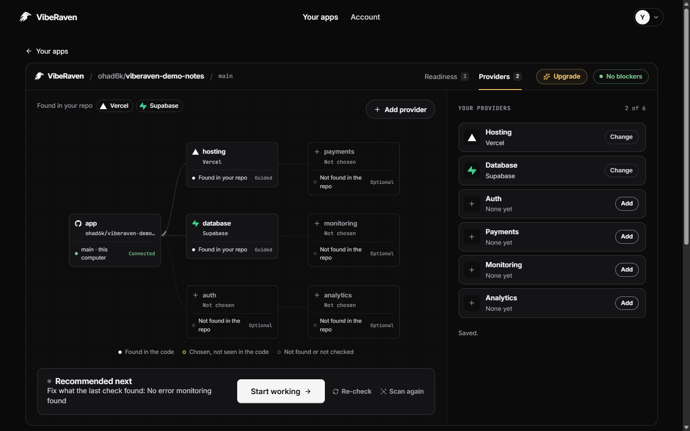
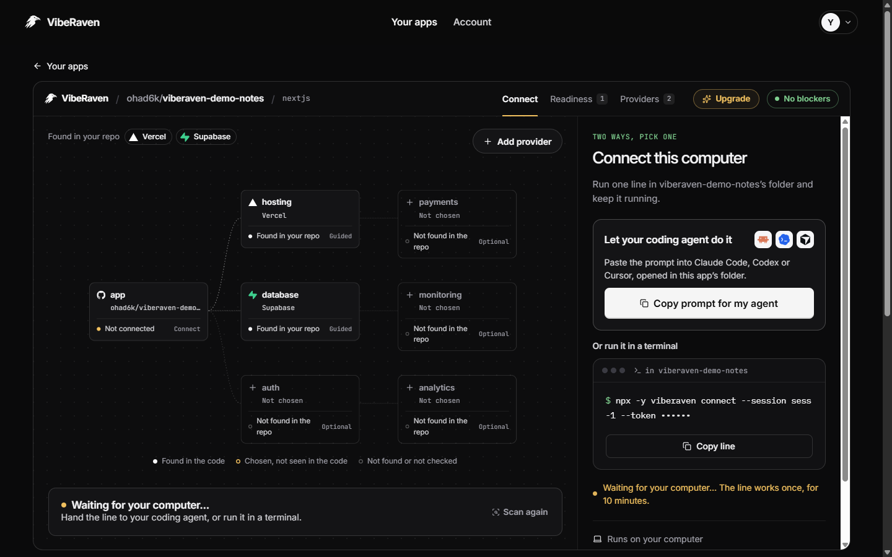
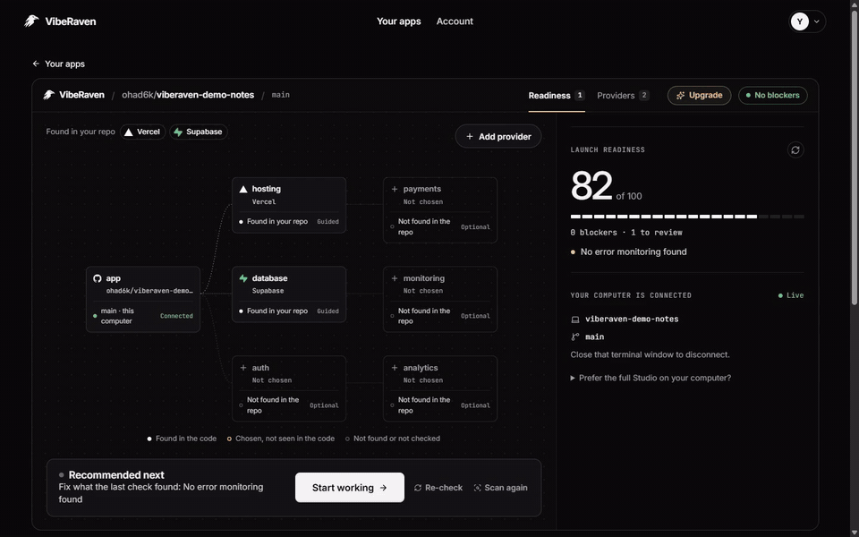

<div align="center">
  
  <h1>VibeRaven</h1>
  <p><strong>Keep changing the app you built with AI, and see that each change works.</strong></p>
  <p>Your own coding agent makes the edit on your computer. VibeRaven shows the steps, runs your checks, opens the running app and keeps the diff, with Undo one click away.</p>

  <p>
    <a href="https://viberaven.dev/try"></a>
    &nbsp;
    <a href="https://www.npmjs.com/package/viberaven"></a>
    &nbsp;
    <a href="https://discord.gg/ZAJvazz63Y"></a>
  </p>

  <p>
    <a href="https://www.npmjs.com/package/viberaven"></a>
    <a href="https://www.npmjs.com/package/viberaven"></a>
    <a href="https://github.com/ohad6k/VibeRaven/stargazers"></a>
    <a href="./LICENSE"></a>
    <a href="https://skills.sh"></a>
    <a href="https://x.com/VibeRavenStatio"></a>
  </p>
  <p>
    <a href="https://viberaven.dev">Website</a> ·
    <a href="#how-it-works">How it works</a> ·
    <a href="#your-first-app-change">Local Studio</a> ·
    <a href="#the-terminal-twin-viberaven-check">Repo check</a> ·
    <a href="#agent-skills">Agent skills</a> ·
    <a href="https://github.com/ohad6k/VibeRaven/releases">Releases</a>
  </p>
</div>

<p align="center">
  
</p>

You built an app with Lovable, Bolt, Cursor, Claude Code or Codex. It runs on Vercel and Supabase, and now every change is a small risk: did the agent break saving, open a table, or touch the wrong file? VibeRaven is the Studio for that next change. It reads your repo, draws your app and its services, lets your agent make the change on your computer, and shows you the proof: the steps it took, your checks, the running app and the diff.

## Two ways to use it

| | **On viberaven.dev** | **Local Studio** |
| --- | --- | --- |
| **Start** | [Sign in with Google](https://viberaven.dev/try), bring your repo, connect your computer once | `npx -y viberaven@1.6.12` in your app's folder |
| **Where it runs** | The page is on the site; your agent works on your computer | Everything on your computer |
| **Price** | 2 free changes, then Pro for 300 changes a month ([pricing](https://viberaven.dev/pricing)) | Free and open source, no account |
| **Good for** | The guided flow: map, one next step, 3D Studio | Working offline and in your own terminal |

Both need Node.js 20 or newer and a coding agent you are signed in to: Claude Code, Codex or Gemini CLI. Your agent's own account and limits apply.

## How it works

<table>
  <tr>
    <td width="50%"></td>
    <td width="50%"></td>
  </tr>
  <tr>
    <td><strong>1. Bring your app.</strong> Paste the GitHub link, or connect GitHub to pick a private repo. Nothing is cloned or changed.</td>
    <td><strong>2. See your app.</strong> The scan draws your app and its services, marks what it found in the code and what is missing, and gives one next step.</td>
  </tr>
  <tr>
    <td></td>
    <td></td>
  </tr>
  <tr>
    <td><strong>3. Connect your computer once.</strong> Copy one prompt for your coding agent, or run the one line yourself in the app's folder.</td>
    <td><strong>4. Start working.</strong> The map becomes the Studio. Pick a starting action or write your own request, in Ask (plan only) or Edit.</td>
  </tr>
</table>

**5. Check the result.** Watch the real steps, read your checks, open the running app and review the diff. With Claude Code, **Undo** puts the agent's files back byte for byte if they have not changed again. Nothing is deployed for you.

## Your first app change

The same workflow, fully local, with no account:

1. **Open your project.** Run `npx -y viberaven@1.6.12` in its folder. The Studio opens in your browser.
2. **Connect your agent.** Open **Agents**, select your installed CLI, run **Test connection**, then choose **Use this agent**.
3. **Show your app.** Choose **Show my app** to start its development server.
4. **Ask for a small change.** Pick Ask to get a plan without edits, or Edit to let the agent change files, then select **Make the change**.
5. **Check the result.** Try the running app, read the check results and open **Review** for the diff. Missing tests are reported as unchecked; a page that loads does not prove every feature works.

On Windows PowerShell, use `npx.cmd` if execution policy blocks `npx`.

## Before deploying a Vercel + Supabase app

Want to find Supabase tables missing RLS in your migrations before launch? [Run the before-and-after example](./examples/proof/missing-rls/). It shows the exact migration finding and how the verdict changes after owner policies are added. The check reads repository files; the policies that are live in your Supabase project still need their own check.

## What the Studio gives you

| | What it does |
| --- | --- |
| **Your agent, your machine** | Claude Code, Codex or Gemini CLI make the edit in your folder, with a connection test and Ask or Edit access. |
| **Proof next to the change** | The real steps, your project's checks, the running app and the diff, in one place. |
| **Review and Undo** | Read every changed file. Undo restores attributed Claude Code edits; anything else stays for you to review. |
| **Your app's services** | Vercel, Supabase, Stripe, auth, monitoring and analytics on one map, each marked found in the code, chosen, or missing. Repo evidence is never shown as a live provider check. |
| **Versions and releases** | Compare release points and see what changed since an earlier version (local Studio). |
| **Repository checks** | File evidence for Vercel + Supabase gaps: RLS in migrations, client keys, env templates and Stripe webhook verification. |

## The terminal twin: `viberaven check`

The same verdict without the Studio:

- In a terminal or CI: `npx -y viberaven@1.6.12 check`
- For coding agents: `npx -y viberaven@1.6.12 --agent-mode`
- Windows PowerShell: use `npx.cmd` if `npx` is blocked by the execution policy.

Output captured from the built 1.6.6 release candidate of VibeRaven on a synthetic Next.js + Supabase app (project path shortened):

```text
viberaven check · ~/my-app

🔴 No RLS policy proof in migrations  (rls_disabled)
   1 public table without row level security: public.profiles (supabase/migrations/0001_init.sql:1). The Data API does not enforce row restrictions for roles and operations allowed by the table's grants. Verify those grants to determine who can read or change rows.
🔴 Service role key in a client-prefixed env variable  (service_role_key_in_client_env)
   .env.example:3: NEXT_PUBLIC_SUPABASE_SERVICE_ROLE_KEY names a service role or secret key under the NEXT_PUBLIC_ prefix. NEXT_PUBLIC_* variables are exposed to client code by Next.js, so anyone who loads the app can read it and skip RLS entirely. Rename it without the prefix, read it only in server code, and rotate the key.
⚪ No error monitoring detected  (missing_monitoring)
   No Sentry/PostHog (or similar) instrumentation was found. Production errors will only surface when users complain.

Verdict: ❌ 2 blockers, 0 warnings · score 55
Fix: viberaven fix · Details: ~/my-app\.viberaven\agent-tasklist.md
```

Each finding names its gap ID, and most name the file that caused it. The command exits `1` when there are blockers. Then:

```bash
npx -y viberaven@1.6.12 fix            # list gaps with safe automatic recipes
npx -y viberaven@1.6.12 fix --gap <id> # apply one recipe
npx -y viberaven@1.6.12 --strict       # the verdict as an exit code for CI, if you want one (exit 1 on not_clear; warnings exit 0)
```

All results land in `.viberaven/` as markdown and JSON on disk (`agent-tasklist.md`, `gate-result.json`, `context-map.json`), so any agent and your git history can read them.

## In CI: the GitHub Action

Lovable and Bolt push straight to `main`, so a pull request check alone misses most of their changes. The [VibeRaven GitHub Action](https://github.com/marketplace/actions/viberaven-supabase-launch-check) runs the same check on pull requests and on pushes, in your own runner:

```yaml
on:
  push:
    branches: [main]
  pull_request:
permissions:
  contents: write
  pull-requests: write
jobs:
  check:
    runs-on: ubuntu-latest
    steps:
      - uses: actions/checkout@v5
        with:
          fetch-depth: 0
      - uses: ohad6k/viberaven-action@v1
```

A pull request gets one comment with what the change added or fixed. A push to `main` gets a commit comment when there is a blocker. It is advice by default; with `fail-on-blockers: 'true'` the job fails when it finds a blocker, and your branch protection decides what that means for merging. `npx -y viberaven@1.6.12 init --github` writes a pull-request-only version of this workflow without the Action.

## Install for AI agents

Make agents use release and provider context before they patch the repo:

```bash
npx -y viberaven@1.6.12 init --agents all
npx -y viberaven@1.6.12 doctor --agents
```

Preview without writing files:

```bash
npx -y viberaven@1.6.12 init --agents all --dry-run
```

This installs bounded rules (`<!-- VIBERAVEN:START -->` ... `<!-- VIBERAVEN:END -->`) into:

- `AGENTS.md`, `CLAUDE.md`, `GEMINI.md`
- `.cursor/rules/viberaven-core.mdc` (plus scoped Supabase, deploy, and payments rules)
- `.github/copilot-instructions.md`
- `.viberaven/agent-context.md`, `.viberaven/mission-map.md`

The rules say when a pass helps (an AI-built app on Vercel + Supabase, before launch or handoff, or after a migration or policy change) and teach the loop: `check`, read `.viberaven/`, fix one gap, then `check` again once per batch of fixes. They are advice, not a gate: the user decides when to ship.

## Agent skills

Six [skills.sh](https://skills.sh) skills route agents through architecture questions, version evidence, and launch proof:

| Skill | Job |
| --- | --- |
| `viberaven` | The router: local check/fix loop, Studio, and MCP context. |
| `architecture-context` | Ask the missing product questions before any edit. |
| `architecture-plan` | Turn answers plus repo evidence into a workstream plan. |
| `what-broke` | Find which version broke the app before patching. |
| `production-context` | Keep compact production memory in `.viberaven/production-context.md`. |
| `go-live` | Local app to GitHub to Vercel, with live-URL proof. |

```bash
npx -y skills@1.7.0 add ohad6k/VibeRaven --skill viberaven
```

See [agent-skills/](./agent-skills/) for the full pack.

This repo also works as an agent **plugin**: `plugin.yaml`, `.claude-plugin/`, `.codex-plugin/`, and `gemini-extension.json` expose the six skills plus `/viberaven-work`, `/viberaven-help`, `/viberaven-production-context`, and `/viberaven-launch` commands to Claude Code, Codex, and Gemini CLI.

For a smaller install, [plugins/viberaven](./plugins/viberaven/) is a standalone plugin for Claude Code and Cursor: one skill that says when a pre-launch pass fits a Vercel + Supabase app, plus a version-pinned MCP server. Its manifests specify the package version; the plugin release is separate from the Studio quickstart above.

## MCP

VibeRaven is listed in the MCP registry for agents that prefer tools over terminal commands:

```json
{ "viberaven": { "command": "npx", "args": ["-y", "@viberaven/mcp@1.6.12"] } }
```

Key tools: `viberaven_check_readiness` (runs the local check), `viberaven_heal_apply`, `viberaven_verify`, `viberaven_audit`, `viberaven_gate_result`, and `viberaven_validate_npm_package` (run it before adding npm dependencies).

## Vercel + Supabase

```bash
npx -y viberaven@1.6.12 audit --vercel-supabase
```

Repository evidence for RLS, service-role exposure, and pooler ports. It reads repo files only, so it cannot show which RLS policies are live in your Supabase project.

## Checks and accounts

- **Local Studio and repository checks.** These run on your machine without a VibeRaven account. The CLI has no telemetry.
- **Changes from viberaven.dev.** Sign in with Google. Free includes 2 changes per account; [Pro](https://viberaven.dev/pricing) includes 300 a month. Your coding agent's account and usage are separate. The site stores requests, progress, check results, file paths and redacted, size-limited diffs so you can review them.
- **Hosted full checks.** Optional: 2 on Free, 50 a month on Pro, separate from changes.
- **Markdown on disk.** All context lives in `.viberaven/` as plain files that your agent and your git history can read.
- **Evidence over vibes.** Findings point at repo evidence. Provider dashboard state is never claimed from repo edits alone.
- **Changes under your control.** Review the plan and access mode before the agent edits your project. Cleanup is plan-only. A clear repository check is not a security audit or proof that the deployed app works.

## Contributing

Contributions are welcome, and most of them need no private source access:

- Read the [contribution guide](./CONTRIBUTING.md) for repo structure, PR expectations, and local checks.
- Pick up a [good first issue](https://github.com/ohad6k/VibeRaven/issues?q=is%3Aissue+is%3Aopen+label%3A%22good+first+issue%22): docs, provider fixtures, examples, and translations.
- Share ideas or questions in [Discussions](https://github.com/ohad6k/VibeRaven/discussions).
- Join the [Discord](https://discord.gg/ZAJvazz63Y) to talk to the maintainer directly.

## Resources

- Agent-ready starter template: [examples/nextjs-supabase-vercel-production-ready-template](./examples/nextjs-supabase-vercel-production-ready-template/)
- Machine-readable docs: [llms.txt](./llms.txt) · [llms-full.txt](https://viberaven.dev/llms-full.txt) · [skills.json](https://viberaven.dev/skills.json) · [skills.sh.json](./skills.sh.json)
- Example proof artifacts: [examples/proof/](./examples/proof/)
- Website: [viberaven.dev](https://viberaven.dev) · npm: [viberaven](https://www.npmjs.com/package/viberaven) · Issues: [ohad6k/VibeRaven/issues](https://github.com/ohad6k/VibeRaven/issues)

## License

[MIT](./LICENSE). Current public release: `viberaven@1.6.12`.

Built by Ohad Krispin ([github.com/ohad6k](https://github.com/ohad6k)).

If VibeRaven helps you ship, star the repo so other AI app builders can find it. Use **Watch → Custom → Releases** for release notifications.

> VibeRaven public repo is the agent discovery and installation surface. Product source code and service internals live in a private repository.
