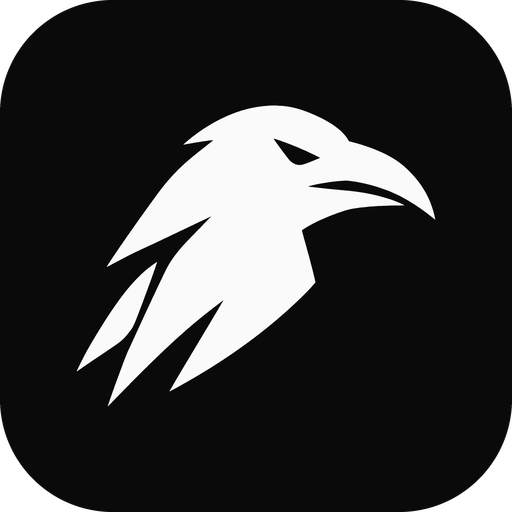

<div align="center">
  
  <h1>VibeRaven</h1>
  <p>A workspace for maintaining the full-stack app you built with AI.</p>

  <p>
    <a href="https://viberaven.dev"></a>
    &nbsp;
    <a href="https://www.npmjs.com/package/viberaven"></a>
    &nbsp;
    <a href="https://discord.gg/ZAJvazz63Y"></a>
  </p>

  <p>
    <a href="https://www.npmjs.com/package/viberaven"></a>
    <a href="https://www.npmjs.com/package/viberaven"></a>
    <a href="https://github.com/ohad6k/VibeRaven/stargazers"></a>
    <a href="./LICENSE"></a>
    <a href="https://skills.sh"></a>
    <a href="https://x.com/VibeRavenStatio"></a>
  </p>
  <p>
    <a href="https://viberaven.dev">Website</a> ·
    <a href="#your-first-app-change">Quickstart</a> ·
    <a href="#agent-skills">Agent skills</a> ·
    <a href="https://github.com/ohad6k/VibeRaven/releases">Releases</a> ·
    <a href="https://github.com/ohad6k/VibeRaven/discussions">Discussions</a>
  </p>
</div>

Changing an app means more than asking an agent to edit code. You need to see the result, review what changed, run the project's checks and keep track of its services and releases. VibeRaven brings that work into one Studio for an existing app. Your connected coding agent makes the edits; the running app, diff and checks stay alongside its provider and version context.

```bash
npx -y viberaven@1.6.8
```

Run the command from your app's Git repository. You need Node.js 20 or later and a supported coding CLI installed and signed in for agent changes. VibeRaven checks the connection before use. Your coding agent's own access and usage limits still apply.

The Studio and repository checks are free. Optional hosted full checks use a VibeRaven account and its allowance; see [Checks and accounts](#checks-and-accounts). Version 1.6.8 includes the app-change workflow below.

## Your first app change

1. **Open your project.** Run `npx -y viberaven@1.6.8` in its folder. The Studio opens in your browser.
2. **Connect your agent.** Open **Agents**, select your installed CLI, run **Test connection**, then choose **Use this agent**. The walkthrough for this release was tested with Claude Code.
3. **Show your app.** Choose **Show my app** and start its development server. Preview availability depends on the project's dev script and supported setup.
4. **Ask for a small change.** For example, change a heading in your app. Review the plan, choose the access mode and select **Make the change**. Ask mode plans without making changes; Edit permits repo edits; Full gives the supported CLI broader access.
5. **Check the result.** Try the running app, read the project's check results and open **Review** for the diff. Missing tests are reported as unchecked; a page loading does not prove every feature works.

With Claude Code, **Undo** can restore files attributed to confirmed agent edits if they have not changed again since the run. Files it cannot attribute stay for manual review. Shell-based edits and Codex/Gemini runs do not get automatic Undo in this release. Restores keep backups; there is no one-click redo yet.

On Windows PowerShell, use `npx.cmd` if execution policy blocks `npx`. The [agent skills](#agent-skills) are optional; installing the whole pack is not required to try this workflow.

## Before deploying a Vercel + Supabase app

Want to find Supabase tables missing RLS in your migrations before launch? [Run the before-and-after example](./examples/proof/missing-rls/). It shows the exact migration finding and how the repo verdict changes after owner policies are added. The check reads repository files; deployed database policies still need separate verification.

## What the Studio gives you

| Capability | What it does |
| --- | --- |
| **Agent work on your repo** | Use connected Claude Code, Codex or Gemini CLI, with a connection test and explicit access modes. |
| **Running app and checks** | See the app preview, the requested change, project check results and the diff together. |
| **Review and Undo** | Inspect changes from a run. Automatic Undo is limited to attributed Claude Code edits; other changes require manual review. |
| **Services and provider context** | Keep detected services and available provider MCP status in view and pass context into agent work. Repo evidence and live provider evidence remain separate. |
| **Versions and releases** | Compare release points and review what changed since an earlier version. |
| **Repository checks** | Find file evidence for Vercel + Supabase gaps, including RLS migrations, client keys, environment templates and Stripe webhook verification. |

Dedicated setup actions for Google/GitHub sign-in, databases, payments and deployment are planned. Their labelled demo scenes are not working provider integrations. Code changes do not establish that live provider settings or policies are correct.

## The terminal twin: `viberaven check`

The same verdict without the Studio:

- In a terminal or CI: `npx -y viberaven@1.6.8 check`
- For coding agents: `npx -y viberaven@1.6.8 --agent-mode`
- Windows PowerShell: use `npx.cmd` if `npx` is blocked by the execution policy.

Output captured from the built VibeRaven 1.6.6 release candidate on a synthetic Next.js + Supabase app (project path shortened):

```text
viberaven check · ~/my-app

🔴 No RLS policy proof in migrations  (rls_disabled)
   1 public table without row level security: public.profiles (supabase/migrations/0001_init.sql:1). The Data API does not enforce row restrictions for roles and operations allowed by the table's grants. Verify those grants to determine who can read or change rows.
🔴 Service role key in a client-prefixed env variable  (service_role_key_in_client_env)
   .env.example:3: NEXT_PUBLIC_SUPABASE_SERVICE_ROLE_KEY names a service role or secret key under the NEXT_PUBLIC_ prefix. NEXT_PUBLIC_* variables are exposed to client code by Next.js, so anyone who loads the app can read it and skip RLS entirely. Rename it without the prefix, read it only in server code, and rotate the key.
⚪ No error monitoring detected  (missing_monitoring)
   No Sentry/PostHog (or similar) instrumentation was found. Production errors will only surface when users complain.

Verdict: ❌ 2 blockers, 0 warnings · score 55
Fix: viberaven fix · Details: ~/my-app\.viberaven\agent-tasklist.md
```

Each finding names its gap ID, and most name the file that caused it. The command exits `1` when there are blockers. Then:

```bash
npx -y viberaven@1.6.8 fix            # list gaps with safe automatic recipes
npx -y viberaven@1.6.8 fix --gap <id> # apply one recipe
npx -y viberaven@1.6.8 --strict       # the verdict as an exit code for CI, if you want one (exit 1 on not_clear; warnings exit 0)
```

All results land in `.viberaven/` as markdown and JSON on disk (`agent-tasklist.md`, `gate-result.json`, `context-map.json`), so any agent and your git history can read them.

## In CI: the GitHub Action

Lovable and Bolt push straight to `main`, so a pull request check alone misses most of their changes. The [VibeRaven GitHub Action](https://github.com/marketplace/actions/viberaven-supabase-launch-check) runs the same check on pull requests and on pushes, in your own runner:

```yaml
on:
  push:
    branches: [main]
  pull_request:
permissions:
  contents: write
  pull-requests: write
jobs:
  check:
    runs-on: ubuntu-latest
    steps:
      - uses: actions/checkout@v5
        with:
          fetch-depth: 0
      - uses: ohad6k/viberaven-action@v1
```

A pull request gets one comment with what the change added or fixed. A push to `main` gets a commit comment when there is a blocker. It is advice by default; with `fail-on-blockers: 'true'` the job fails when it finds a blocker, and your branch protection decides what that means for merging. `npx -y viberaven@1.6.8 init --github` writes a pull-request-only version of this workflow without the Action.

## Install for AI agents

Make agents use release and provider context before they patch the repo:

```bash
npx -y viberaven@1.6.8 init --agents all
npx -y viberaven@1.6.8 doctor --agents
```

Preview without writing files:

```bash
npx -y viberaven@1.6.8 init --agents all --dry-run
```

This installs bounded rules (`<!-- VIBERAVEN:START -->` ... `<!-- VIBERAVEN:END -->`) into:

- `AGENTS.md`, `CLAUDE.md`, `GEMINI.md`
- `.cursor/rules/viberaven-core.mdc` (plus scoped Supabase, deploy, and payments rules)
- `.github/copilot-instructions.md`
- `.viberaven/agent-context.md`, `.viberaven/mission-map.md`

The rules say when a pass helps (an AI-built app on Vercel + Supabase, before launch or handoff, or after a migration or policy change) and teach the loop: `check`, read `.viberaven/`, fix one gap, then `check` again once per batch of fixes. They are advice, not a gate: the user decides when to ship.

## Agent skills

Six [skills.sh](https://skills.sh) skills route agents through architecture questions, version evidence, and launch proof:

| Skill | Job |
| --- | --- |
| `viberaven` | The router: local check/fix loop, Studio, and MCP context. |
| `architecture-context` | Ask the missing product questions before any edit. |
| `architecture-plan` | Turn answers plus repo evidence into a workstream plan. |
| `what-broke` | Find which version broke the app before patching. |
| `production-context` | Keep compact production memory in `.viberaven/production-context.md`. |
| `go-live` | Local app to GitHub to Vercel, with live-URL proof. |

```bash
npx -y skills@1.7.0 add ohad6k/VibeRaven --skill viberaven
```

See [agent-skills/](./agent-skills/) for the full pack.

This repo also works as an agent **plugin**: `plugin.yaml`, `.claude-plugin/`, `.codex-plugin/`, and `gemini-extension.json` expose the six skills plus `/viberaven-work`, `/viberaven-help`, `/viberaven-production-context`, and `/viberaven-launch` commands to Claude Code, Codex, and Gemini CLI.

For a smaller install, [plugins/viberaven](./plugins/viberaven/) is a standalone plugin for Claude Code and Cursor: one skill that says when a pre-launch pass fits a Vercel + Supabase app, plus a version-pinned MCP server. Its manifests specify the package version; the plugin release is separate from the Studio quickstart above.

## MCP

VibeRaven is listed in the MCP registry for agents that prefer tools over terminal commands:

```json
{ "viberaven": { "command": "npx", "args": ["-y", "@viberaven/mcp@1.6.8"] } }
```

Key tools: `viberaven_check_readiness` (runs the local check), `viberaven_heal_apply`, `viberaven_verify`, `viberaven_audit`, `viberaven_gate_result`, and `viberaven_validate_npm_package` (run it before adding npm dependencies).

## Vercel + Supabase

```bash
npx -y viberaven@1.6.8 audit --vercel-supabase
```

Repository evidence for RLS, service-role exposure, and pooler ports. It reads repo files only, so it cannot show which RLS policies are live in your Supabase project.

## Checks and accounts

- **Studio and repository checks.** These run on your machine without a VibeRaven account. Agent changes use your connected coding CLI and its account; they are separate from the repository checks. The CLI has no telemetry.
- **Hosted full checks.** These are optional and use your VibeRaven account's allowance: 2 on Free, 50 a month on [Pro](https://viberaven.dev/pricing). They are separate from using your own coding agent in the Studio.
- **Markdown on disk.** All context lives in `.viberaven/` as plain files that your agent and your git history can read.
- **Evidence over vibes.** Findings point at repo evidence. Provider dashboard state is never claimed from repo edits alone.
- **Changes under your control.** Review the plan and access mode before the agent edits your project. Cleanup is plan-only. A clear repository check is not a security audit or proof that the deployed app works.

## Contributing

Contributions are welcome, and most of them need no private source access:

- Read the [contribution guide](./CONTRIBUTING.md) for repo structure, PR expectations, and local checks.
- Pick up a [good first issue](https://github.com/ohad6k/VibeRaven/issues?q=is%3Aissue+is%3Aopen+label%3A%22good+first+issue%22): docs, provider fixtures, examples, and translations.
- Share ideas or questions in [Discussions](https://github.com/ohad6k/VibeRaven/discussions).
- Join the [Discord](https://discord.gg/ZAJvazz63Y) to talk to the maintainer directly.

## Resources

- Agent-ready starter template: [examples/nextjs-supabase-vercel-production-ready-template](./examples/nextjs-supabase-vercel-production-ready-template/)
- Machine-readable docs: [llms.txt](./llms.txt) · [llms-full.txt](https://viberaven.dev/llms-full.txt) · [skills.json](https://viberaven.dev/skills.json) · [skills.sh.json](./skills.sh.json)
- Example proof artifacts: [examples/proof/](./examples/proof/)
- Website: [viberaven.dev](https://viberaven.dev) · npm: [viberaven](https://www.npmjs.com/package/viberaven) · Issues: [ohad6k/VibeRaven/issues](https://github.com/ohad6k/VibeRaven/issues)

## License

[MIT](./LICENSE). Current public release: `viberaven@1.6.8`.

Built by Ohad Krispin ([github.com/ohad6k](https://github.com/ohad6k)).

If VibeRaven helps you ship, star the repo so other AI app builders can find it. Use **Watch → Custom → Releases** for release notifications.

> VibeRaven public repo is the agent discovery and installation surface. Product source code and service internals live in a private repository.
