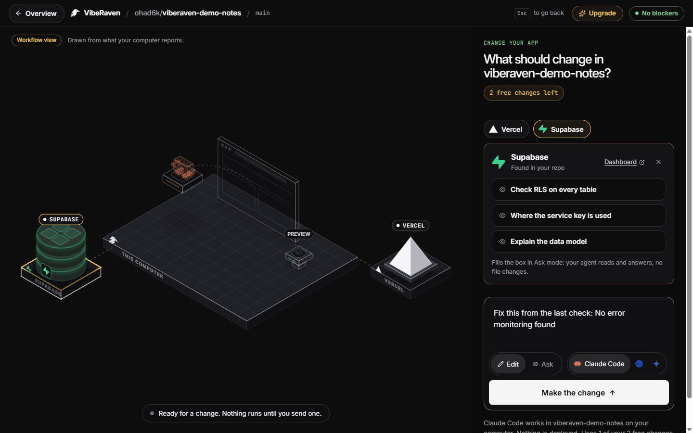

<div align="center">
  
  <h1>VibeRaven</h1>
  <p>VibeRaven checks AI-built apps on Vercel + Supabase for launch gaps before you ship: tables without RLS, permissive policies such as <code>using (true)</code>, service_role keys in client code, anon-callable security definer functions, the wrong pooler port and unverified Stripe webhooks.</p>
  <p>Run <code>npx -y viberaven@1.6.12 check</code> in your app's folder. It reads the repository on your machine, needs no account, and names the file and line for each gap.</p>

  <p>
    <a href="https://www.npmjs.com/package/viberaven"></a>
    &nbsp;
    <a href="https://viberaven.dev/try"></a>
    &nbsp;
    <a href="https://discord.gg/ZAJvazz63Y"></a>
  </p>

  <p>
    <a href="https://www.npmjs.com/package/viberaven"></a>
    <a href="https://www.npmjs.com/package/viberaven"></a>
    <a href="https://github.com/ohad6k/VibeRaven/stargazers"></a>
    <a href="./LICENSE"></a>
    <a href="https://skills.sh"></a>
    <a href="https://x.com/VibeRavenStatio"></a>
  </p>
  <p>
    <a href="https://viberaven.dev">Website</a> ·
    <a href="#what-it-checks">What it checks</a> ·
    <a href="#when-to-use-it-and-when-not-to">When to use it</a> ·
    <a href="#how-it-compares">How it compares</a> ·
    <a href="#the-local-studio">Local Studio</a> ·
    <a href="#agent-skills">Agent skills</a> ·
    <a href="https://github.com/ohad6k/VibeRaven/releases">Releases</a>
  </p>
</div>

## Quick start

Requires Node.js 20 or newer. From your app's project root:

```bash
npx -y viberaven@1.6.12 check
```

- In a terminal or CI: `npx -y viberaven@1.6.12 check`
- For coding agents: `npx -y viberaven@1.6.12 --agent-mode`
- Windows PowerShell: use `npx.cmd` if `npx` is blocked by the execution policy.

It reads `supabase/migrations`, your client and server code, `package.json` and `.env.example`. It does not connect to your Supabase project or send requests to your app. It exits `1` when it finds a blocker, so it also works as a CI step.

## What it checks

| Finding | Gap ID | Related Supabase Security Advisor lint |
| --- | --- | --- |
| A public table created in a migration with row level security never enabled | `rls_disabled` | `rls_disabled_in_public` ([guide](https://viberaven.dev/supabase-rls-disabled-in-public)) |
| A policy with `using (true)` that lets anyone read or write every row | `rls_policy_allows_all_write`, `rls_policy_allows_all_read` | none |
| The service_role key in a file that ships to the browser, or under a `NEXT_PUBLIC_` name | `service_role_key_in_client_code`, `service_role_key_in_client_env` | none |
| A security definer function in `public` that no migration closes to `anon` | `security_definer_function_executable` | `anon_security_definer_function_executable` ([guide](https://viberaven.dev/supabase-security-definer-function-anon)) |
| A direct Postgres connection on port 5432 from serverless code, instead of the transaction pooler on 6543 | `pooler_port_mismatch` | none |
| A Stripe webhook handler that never checks the signature over the raw body | `unverified_stripe_webhook` | none |
| Env vars that code reads but `.env.example` does not list, queries with no row limit, no error monitoring | `env_var_drift`, `unbounded_query`, `missing_monitoring` | none |

Two other Security Advisor lints come up often in the same apps. VibeRaven has no rule for them yet, and the guides explain the fix:

- `security_definer_view`: [what it means and how to fix it](https://viberaven.dev/supabase-security-definer-view)
- `function_search_path_mutable`: [what it means and how to fix it](https://viberaven.dev/supabase-function-search-path-mutable)

For a before-and-after run on one migration, see the [missing-RLS example](./examples/proof/missing-rls/).

## Example output

From `viberaven check` 1.6.12 on a synthetic Next.js + Supabase app with one of each gap (project path shortened):

```text
viberaven check · ~/my-app

🔴 No RLS policy proof in migrations  (rls_disabled)
   1 public table without row level security: public.profiles (supabase/migrations/20260301000000_init.sql:1). The Data API does not enforce row restrictions for roles and operations allowed by the table's grants. Verify those grants to determine who can read or change rows.
🔴 A policy lets anyone write every row  (rls_policy_allows_all_write)
   Policy "orders are editable" on public.orders (supabase/migrations/20260301000000_init.sql:13) lets anyone, signed in or not, update every row, to any values: using (true).
🔴 Service role key used in client code  (service_role_key_in_client_code)
   app/admin/page.tsx:4: creates a Supabase client with the service role key. This file ships to the browser, and the service role key skips RLS entirely. Move the call behind a server route or edge function and rotate the key.
🟡 Supabase connection is not using the pooler port  (pooler_port_mismatch)
   Found direct 5432 DATABASE_URL/POSTGRES_URL evidence. Vercel/serverless deployments should prefer Supabase transaction pooler port 6543.
🟡 Security definer function callable by the Data API roles  (security_definer_function_executable)
   public.grant_credits(uuid, integer) at supabase/migrations/20260301000000_init.sql:15 is security definer, so it runs with its owner's rights and RLS does not limit what it touches. No migration revokes EXECUTE from public, anon, authenticated, so anyone holding the anon key can call it at /rest/v1/rpc/grant_credits. If only the server calls it, add: revoke execute on function public.grant_credits(uuid, integer) from public, anon, authenticated; Fix: revoke execute on function public.grant_credits(uuid, integer) from public, anon, authenticated;
🟡 Stripe webhook does not verify the signature  (unverified_stripe_webhook)
   1 Stripe webhook handler without signature verification over the raw body: app/api/stripe/webhook/route.ts (no signature check (constructEvent), no stripe-signature header, no raw body). Anyone who finds the URL can post a fake event, for example a paid checkout.
🟡 Env vars used in code but missing from .env.example  (env_var_drift)
   Code reads 1 environment variable that .env.example does not document (NEXT_PUBLIC_SUPABASE_SERVICE_ROLE_KEY). Fresh clones, CI, and the production deploy can silently run without them.
🟡 Database queries with no row limit  (unbounded_query)
   1 file run Supabase selects or Prisma findMany with no .limit()/.range()/take bound (app\admin\page.tsx). These work with 50 test rows and melt with 50,000 production rows.
⚪ No error monitoring detected  (missing_monitoring)
   No Sentry/PostHog (or similar) instrumentation was found. Production errors will only surface when users complain.

Verdict: ❌ 3 blockers, 5 warnings · score 5
Fix: viberaven fix · Details: ~/my-app\.viberaven\agent-tasklist.md
```

Every result also lands in `.viberaven/` as markdown and JSON (`agent-tasklist.md`, `gate-result.json`, `context-map.json`), so a coding agent and your git history can read it.

## When to use it, and when not to

Use it:

- before you launch or hand off a Vercel + Supabase app built with Lovable, Bolt, Cursor, Claude Code or Codex;
- after a Supabase migration or a policy change;
- when a production error points at RLS, the service_role key, env vars, the database connection or a Stripe webhook;
- on every push or pull request, through the GitHub Action below.

It is not the right tool when:

- **You need to know what is live in the database.** VibeRaven is a repository check, not a live database test. It reads migrations, so it cannot see a policy someone added in the Supabase dashboard. Use Supabase Security Advisor for the live project.
- **You need a full security audit.** It does not send requests to your app, test for XSS or CSRF, or look up dependency CVEs. A clear result is not a security audit.
- **You need to know the app works.** It does not run your build or click through your pages. Use Playwright or your own tests.
- **The app does not use Supabase.** Most of the checks have nothing to read.

## How it compares

These tools answer different questions, and most launches need more than one of them.

| Tool | What it checks | Where it runs | How it fits with VibeRaven |
| --- | --- | --- | --- |
| [Supabase Security Advisor](https://supabase.com/docs/guides/observability/advisors) | Lints on the live database: RLS disabled, security definer views and functions, mutable search_path and more | Supabase dashboard, against the deployed project | Advisor sees what is live. VibeRaven reads the migrations before they are applied, plus the client code and env files the database never sees. |
| [OWASP ZAP](https://www.zaproxy.org/) | Dynamic scan of a running web app over HTTP: injection, XSS, headers, cookies | Against a deployed or local URL | ZAP tests the app from outside. VibeRaven reads the repo and knows Supabase grants, policies and keys. |
| [Semgrep](https://semgrep.dev/), [Snyk](https://snyk.io/), [CodeQL](https://codeql.github.com/) | General static analysis and dependency vulnerabilities across many languages | CI or locally, on source code | Broad code rules and CVEs. VibeRaven is narrow: Supabase RLS and grants, service_role exposure, the pooler port and Stripe webhooks. |
| [Playwright](https://playwright.dev/) | End-to-end tests you write, driving a real browser | Locally or in CI, against a running app | Playwright proves the flows you test. A test that signs in as user A and tries to read user B's rows is the live check that VibeRaven's RLS findings point to. |

## Data: 512 public Lovable apps

We ran the check on the Supabase migrations of 512 public Lovable repos. From the [write-up](https://viberaven.dev/blog/supabase-security-definer-functions-512-lovable-repos):

> In a static read of 512 public Lovable projects on GitHub with a supabase/migrations folder (October 2026), 47.3% (242) define at least one security definer function in the public schema that a signed-out caller with the anon key can run at /rest/v1/rpc.

The post has the method, the limits and the fix. An [earlier post](https://viberaven.dev/blog/supabase-policies-512-lovable-repos) covers RLS policies in the same 512 apps.

## Fix the gaps

```bash
npx -y viberaven@1.6.12 fix                         # list gaps with safe automatic recipes
npx -y viberaven@1.6.12 fix --gap <id> --dry-run    # preview one recipe
npx -y viberaven@1.6.12 fix --gap <id>              # apply it
npx -y viberaven@1.6.12 audit --vercel-supabase     # RLS in migrations, pooler port, service_role key
npx -y viberaven@1.6.12 --strict                    # the verdict as an exit code for CI (exit 1 on not_clear; warnings exit 0)
```

The `rls_disabled` recipe adds a migration that enables RLS without policies, so browser reads return no rows until you add policies. Agree before applying it, then apply and test it through your database workflow.

## In CI: the GitHub Action

Lovable and Bolt push straight to `main`, so a pull request check alone misses most of their changes. The [VibeRaven GitHub Action](https://github.com/marketplace/actions/viberaven-supabase-launch-check) runs the same check on pull requests and on pushes, in your own runner:

```yaml
on:
  push:
    branches: [main]
  pull_request:
permissions:
  contents: write
  pull-requests: write
jobs:
  check:
    runs-on: ubuntu-latest
    steps:
      - uses: actions/checkout@v5
        with:
          fetch-depth: 0
      - uses: ohad6k/viberaven-action@v1
```

A pull request gets one comment with what the change added or fixed. A push to `main` gets a commit comment when there is a blocker. It is advice by default; with `fail-on-blockers: 'true'` the job fails when it finds a blocker, and your branch protection decides what that means for merging. `npx -y viberaven@1.6.12 init --github` writes a pull-request-only version of this workflow without the Action.

## Install for AI agents

Give coding agents the same context before they patch the repo:

```bash
npx -y viberaven@1.6.12 init --agents all --dry-run   # preview
npx -y viberaven@1.6.12 init --agents all
npx -y viberaven@1.6.12 doctor --agents
```

This installs bounded rules (`<!-- VIBERAVEN:START -->` ... `<!-- VIBERAVEN:END -->`) into:

- `AGENTS.md`, `CLAUDE.md`, `GEMINI.md`
- `.cursor/rules/viberaven-core.mdc` (plus scoped Supabase, deploy, and payments rules)
- `.github/copilot-instructions.md`
- `.viberaven/agent-context.md`, `.viberaven/mission-map.md`

The rules say when a pass helps (an AI-built app on Vercel + Supabase, before launch or handoff, or after a migration or policy change) and teach the loop: `check`, read `.viberaven/`, fix one gap, then `check` again once per batch of fixes. They are advice, not a gate: the user decides when to ship.

## Agent skills

Six [skills.sh](https://skills.sh) skills route agents through architecture questions, version evidence, and launch proof:

| Skill | Job |
| --- | --- |
| `viberaven` | The router: local check/fix loop, Studio, and MCP context. |
| `architecture-context` | Ask the missing product questions before any edit. |
| `architecture-plan` | Turn answers plus repo evidence into a workstream plan. |
| `what-broke` | Find which version broke the app before patching. |
| `production-context` | Keep compact production memory in `.viberaven/production-context.md`. |
| `go-live` | Local app to GitHub to Vercel, with live-URL proof. |

```bash
npx -y skills@1.7.0 add ohad6k/VibeRaven --skill viberaven
```

See [agent-skills/](./agent-skills/) for the full pack.

This repo also works as an agent **plugin**: `plugin.yaml`, `.claude-plugin/`, `.codex-plugin/`, and `gemini-extension.json` expose the six skills plus `/viberaven-work`, `/viberaven-help`, `/viberaven-production-context`, and `/viberaven-launch` commands to Claude Code, Codex, and Gemini CLI.

For a smaller install, [plugins/viberaven](./plugins/viberaven/) is a standalone plugin for Claude Code and Cursor: one skill that says when a pre-launch pass fits a Vercel + Supabase app, plus a version-pinned MCP server. Its manifests specify the package version; the plugin release is separate from the quick start above.

## MCP

VibeRaven is listed in the MCP registry for agents that prefer tools over terminal commands:

```json
{ "viberaven": { "command": "npx", "args": ["-y", "@viberaven/mcp@1.6.12"] } }
```

Key tools: `viberaven_check_readiness` (runs the local check), `viberaven_heal_apply`, `viberaven_verify`, `viberaven_audit`, `viberaven_gate_result`, and `viberaven_validate_npm_package` (run it before adding npm dependencies).

## The local Studio

`npx -y viberaven@1.6.12` with no command opens the Studio: a local page where your own coding agent (Claude Code, Codex or Gemini CLI) makes a change in your folder, and you see the steps, your checks, the running app and the diff, with Undo one click away.

<p align="center">
  
</p>

## Your first app change

The same workflow, fully local, with no account:

1. **Open your project.** Run `npx -y viberaven@1.6.12` in its folder. The Studio opens in your browser.
2. **Connect your agent.** Open **Agents**, select your installed CLI, run **Test connection**, then choose **Use this agent**.
3. **Show your app.** Choose **Show my app** to start its development server.
4. **Ask for a small change.** Pick Ask to get a plan without edits, or Edit to let the agent change files, then select **Make the change**.
5. **Check the result.** Try the running app, read the check results and open **Review** for the diff. Missing tests are reported as unchecked; a page that loads does not prove every feature works.

On Windows PowerShell, use `npx.cmd` if execution policy blocks `npx`.

The Studio also runs on [viberaven.dev](https://viberaven.dev/try): sign in with Google, bring your repo, and connect your computer once. Your agent still works on your computer. The site includes 2 free changes, then [Pro](https://viberaven.dev/pricing) for 300 changes a month. Both need a coding agent you are signed in to; its own account and limits apply.

| | What the Studio gives you |
| --- | --- |
| **Your agent, your machine** | Claude Code, Codex or Gemini CLI make the edit in your folder, with a connection test and Ask or Edit access. |
| **Proof next to the change** | The real steps, your project's checks, the running app and the diff, in one place. |
| **Review and Undo** | Read every changed file. Undo restores attributed Claude Code edits; anything else stays for you to review. |
| **Your app's services** | Vercel, Supabase, Stripe, auth, monitoring and analytics on one map, each marked found in the code, chosen, or missing. Repo evidence is never shown as a live provider check. |
| **Versions and releases** | Compare release points and see what changed since an earlier version (local Studio). |

## Checks and accounts

- **Local Studio and repository checks.** These run on your machine without a VibeRaven account. The CLI has no telemetry.
- **Changes from viberaven.dev.** Sign in with Google. Free includes 2 changes per account; [Pro](https://viberaven.dev/pricing) includes 300 a month. Your coding agent's account and usage are separate. The site stores requests, progress, check results, file paths and redacted, size-limited diffs so you can review them.
- **Hosted full checks.** Optional: 2 on Free, 50 a month on Pro, separate from changes.
- **Markdown on disk.** All context lives in `.viberaven/` as plain files that your agent and your git history can read.
- **Evidence over vibes.** Findings point at repo evidence. Provider dashboard state is never claimed from repo edits alone.
- **Changes under your control.** Review the plan and access mode before the agent edits your project. Cleanup is plan-only. A clear repository check is not a security audit or proof that the deployed app works.

## Contributing

Contributions are welcome, and most of them need no private source access:

- Read the [contribution guide](./CONTRIBUTING.md) for repo structure, PR expectations, and local checks.
- Pick up a [good first issue](https://github.com/ohad6k/VibeRaven/issues?q=is%3Aissue+is%3Aopen+label%3A%22good+first+issue%22): docs, provider fixtures, examples, and translations.
- Share ideas or questions in [Discussions](https://github.com/ohad6k/VibeRaven/discussions).
- Join the [Discord](https://discord.gg/ZAJvazz63Y) to talk to the maintainer directly.

## Resources

- Supabase Security Advisor guides: [all warnings](https://viberaven.dev/supabase-security-advisor-warnings) · [rls_disabled_in_public](https://viberaven.dev/supabase-rls-disabled-in-public) · [security_definer_view](https://viberaven.dev/supabase-security-definer-view) · [function_search_path_mutable](https://viberaven.dev/supabase-function-search-path-mutable) · [anon-callable security definer functions](https://viberaven.dev/supabase-security-definer-function-anon)
- Agent-ready starter template: [examples/nextjs-supabase-vercel-production-ready-template](./examples/nextjs-supabase-vercel-production-ready-template/)
- Machine-readable docs: [llms.txt](./llms.txt) · [llms-full.txt](https://viberaven.dev/llms-full.txt) · [skills.json](https://viberaven.dev/skills.json) · [skills.sh.json](./skills.sh.json)
- Example proof artifacts: [examples/proof/](./examples/proof/)
- Website: [viberaven.dev](https://viberaven.dev) · npm: [viberaven](https://www.npmjs.com/package/viberaven) · Issues: [ohad6k/VibeRaven/issues](https://github.com/ohad6k/VibeRaven/issues)

## License

[MIT](./LICENSE). Current public release: `viberaven@1.6.12`.

Built by Ohad Krispin ([github.com/ohad6k](https://github.com/ohad6k)).

If VibeRaven helps you ship, star the repo so other AI app builders can find it. Use **Watch → Custom → Releases** for release notifications.

> VibeRaven public repo is the agent discovery and installation surface. Product source code and service internals live in a private repository.
